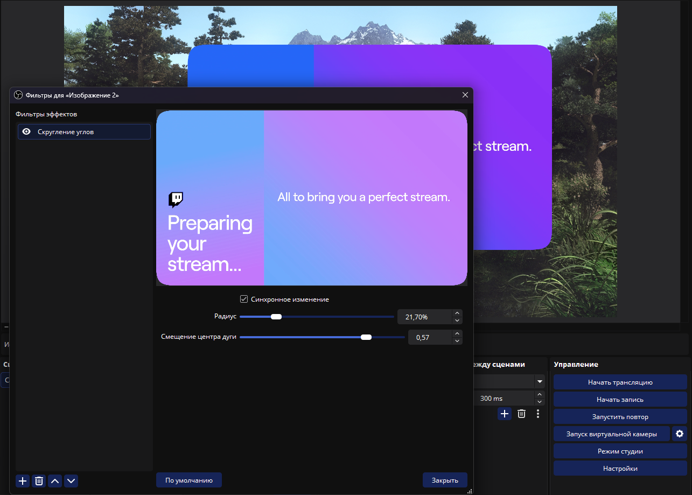
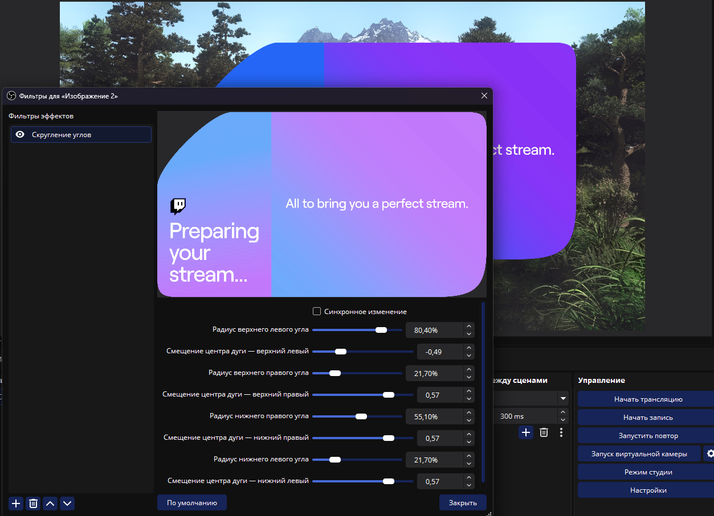

# Rounded Corners for OBS Studio

[Русская версия](README.ru.md)

A GPU filter for OBS Studio that rounds the corners of any video source (camera, window capture, image, browser, media). Each corner can have its own radius and its own curve shape, and the radius is relative to the source size, so the result looks the same on sources of any resolution.




## Features

- Rounded-corner alpha mask rendered on the GPU (pixel shader), no CPU cost per frame.
- Radius in **percent** of the source: 0% = sharp corner, 100% = the largest possible rounding (half of the shorter side).
- **Curve shape** slider: from a straight diagonal cut, through a perfect circular arc, to an almost square corner.
- Per-corner settings (top-left, top-right, bottom-right, bottom-left) or one common value with **Sync**.
- Anti-aliased edges.
- Neighbouring corners can never overlap, whatever the radii are.

## Requirements

- OBS Studio 32 or newer (Windows, x64).

## Installation

### Installer-free (recommended)

1. Close OBS Studio.
2. Download the latest `rounded-corners-windows-x64-*.zip` from the Releases page.
3. Extract it into your OBS folder so that the files end up here:

   ```
   obs-studio/obs-plugins/64bit/rounded-corners.dll
   obs-studio/data/obs-plugins/rounded-corners/effects/rounded-corners.effect
   obs-studio/data/obs-plugins/rounded-corners/locale/*.ini
   ```

   Default OBS folder: `C:\Program Files\obs-studio`.

### Without admin rights (per-user)

Put the files into `%APPDATA%\obs-studio\plugins\rounded-corners\`:

```
%APPDATA%\obs-studio\plugins\rounded-corners\bin\64bit\rounded-corners.dll
%APPDATA%\obs-studio\plugins\rounded-corners\data\effects\rounded-corners.effect
%APPDATA%\obs-studio\plugins\rounded-corners\data\locale\*.ini
```

## Usage

1. Right-click a source in OBS and open **Filters**.
2. Under **Effect Filters** press **+** and add **Rounded Corners**.
3. Adjust the settings.

| Setting | Range | Description |
| --- | --- | --- |
| Sync | on / off | One radius and one shape for all four corners. |
| Radius | 0 - 100 % | Corner size relative to half of the shorter side of the source. |
| Curve shape | -1 ... 1 | `-1` diagonal cut, `0` circular arc, `1` almost square corner. |

With Sync off, every corner has its own radius and shape sliders.

> Tip: preview windows in OBS are scaled down. Check small radii on the real output or in a full-size projector.

## Building from source

The repository contains only the plugin sources (`src/`, `data/`) and a build script. `build.ps1` downloads the official [obs-plugintemplate](https://github.com/obsproject/obs-plugintemplate), drops the plugin files into it, builds the plugin and packages it.

Requirements:

- Windows 10/11 x64
- Visual Studio 2026 (v18) with the "Desktop development with C++" workload and Windows SDK 10.0.26100
- CMake 3.28 or newer
- Internet access (the first run downloads the template and the OBS build dependencies, which can take several minutes)

Build:

```powershell
.\build.ps1
```

If PowerShell blocks the script, run `powershell -ExecutionPolicy Bypass -File .\build.ps1`.

The script cleans `_build-work/` and `dist/` on every run. The result is:

- `rounded-corners-windows-x64-plugin.zip` in the repository root: a ready-to-install archive with the folder layout from the Installation section.
- `_package-staging/`: the unpacked contents of that archive.

All of these are ignored by git.


## Credits and AI disclosure

This project is "vibe-coded". The plugin code, the shader, the build script and the documentation were written by AI assistants: **Claude** (Anthropic) and **ChatGPT** (OpenAI). The human author, [Stexible](https://github.com/Stexible), supplied the idea and direction and did the testing and debugging.

The plugin is provided as is, without warranty. If you rely on it, review the code first. Issues and pull requests are welcome.

## License

See the `LICENSE` file.
